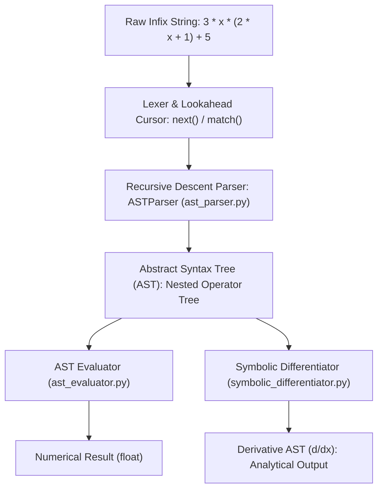
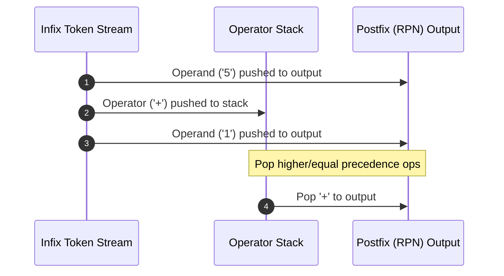

# Formal Grammars, LL(1) Parsers & AST Symbolic Differentiation

[](https://en.wikipedia.org/wiki/C99)
[](https://www.oracle.com/java/)
[](https://www.python.org/)
[](Makefile)
[]()
[](LICENSE)

A robust, polyglot software suite implementing formal grammar recognition, recursive descent parsing, LL(1) predictive analysis, Dijkstra's Shunting-Yard evaluation, and Abstract Syntax Tree (AST) symbolic differentiation across **C99**, **Java 17**, and **Python 3.10+**.

> ### Academic Context
> This repository consolidates core algorithmic implementations developed during the **Theoretical Computer Science (*Theoretische Informatik*)** course at **HTW Dresden**. The codebase has been refactored from academic problem sets into a unified, production-grade multi-language suite adhering to language-specific Clean Code principles, explicit type safety, and automated build workflows.


---

## Architectural Overview

The repository separates grammar specifications, AST manipulations, and language targets into dedicated, modular directories:

```text
formal-grammars-and-parsers/
├── Makefile                              # Unified build and polyglot test orchestrator
├── LICENSE                               # MIT License
├── .gitignore                            # C, Java, and Python artifact hygiene
├── README.md                             # Formal documentation and execution guide
└── src/
    ├── c/                                # Low-level systems implementation (C99)
    │   ├── palindrome_parser.c           # Symmetric word recognition: w x w^R
    │   └── expression_parser.c           # Direct arithmetic evaluation & precedence parsing
    ├── java/                             # Object-oriented grammar recognizer (Java 17+)
    │   └── AnBnParser.java               # Context-free language recognizer: a^n b^n
    └── python/                           # High-level AST generation, LR evaluation, and Calculus
        ├── expression_parser.py          # Recursive descent arithmetic parser
        ├── ast_parser.py                 # Generates recursive ASTs from infix strings
        ├── ast_evaluator.py              # Recursive AST visitor and node evaluator
        ├── symbolic_differentiator.py    # Analytical d/dx differentiation via pattern matching
        ├── infix_to_postfix.py           # Dijkstra's Shunting-Yard conversion algorithm
        ├── postfix_evaluator.py          # Stack-based LR RPN expression evaluator
        └── ll1_parsers.py                # Predictive LL(1) recursive descent parsers
```

### Module Matrix

| Module | Target | Formal Concept | Input Domain / Grammar |
| --- | --- | --- | --- |
| `AnBnParser.java` | Java 17 | Context-Free Language ($L \notin \text{REG}$) | $L = \{ a^n b^n \mid n \ge 0 \}$ |
| `palindrome_parser.c` | C99 | Center-Marked Palindromes | $L = \{ w\,x\,w^R \mid w \in \{a, b, c\}^* \}$ |
| `expression_parser.c` | C99 | Operator Precedence & Associativity | Arithmetic expressions with `sqrt()`, `exp()`, and `^` |
| `expression_parser.py` | Python 3 | Recursive Descent Evaluation | Left/Right-associative arithmetic expressions |
| `ast_parser.py` | Python 3 | Abstract Syntax Tree Construction | Concrete Syntax $\to$ Abstract Hierarchical Trees |
| `ast_evaluator.py` | Python 3 | Tree-Walk Interpreter | Recursive AST evaluation |
| `symbolic_differentiator.py` | Python 3 | Formal Calculus & Symbolic Math | $\frac{d}{dx}$ via Structural Pattern Matching |
| `infix_to_postfix.py` | Python 3 | Shunting-Yard Algorithm | Infix to Reverse Polish Notation (RPN) |
| `postfix_evaluator.py` | Python 3 | Pushdown Automaton Evaluation | $S \to K \mid S\,S\,O$ over an explicit stack |
| `ll1_parsers.py` | Python 3 | Predictive LL(1) Parsing | Disjoint $\text{FIRST}$ & $\text{FOLLOW}$ decision tables |

---

## Theoretical & Mathematical Foundations

### 1. Chomsky Hierarchy & Context-Free Grammars

All languages parsed in this repository reside within **Type 2 (Context-Free Languages)** of the Chomsky Hierarchy, satisfying:

$$G = (V, \Sigma, R, S)$$

Where:

* $V$ is a finite set of non-terminal characters.
* $\Sigma$ is a finite set of terminal characters ($V \cap \Sigma = \emptyset$).
* $R$ is a finite set of production rules of the form $A \to \alpha$, where $A \in V$ and $\alpha \in (V \cup \Sigma)^*$.
* $S \in V$ is the designated start symbol.

#### Classical Non-Regular Language: $a^n b^n$

The language $L = \{a^n b^n \mid n \ge 0\}$ cannot be recognized by any Deterministic Finite Automaton (proven via the Pumping Lemma for Regular Languages). It requires a non-deterministic pushdown mechanism or recursive activation stack:

$$S \to a S b \mid \epsilon$$

#### Center-Marked Palindromes

Recognized by `palindrome_parser.c`:

$$S \to a S a \mid b S b \mid c S c \mid x$$

The terminal $x$ acts as a deterministic center pivot, eliminating non-deterministic branching and enabling linear $\mathcal{O}(n)$ time complexity without backtracking.

---

### 2. Operator Precedence Grammar (EBNF)

Arithmetic evaluation in `expression_parser.c`, `expression_parser.py`, and `ast_parser.py` maps mathematical precedence directly to the call stack depth:

```text
K ::= M { ('+' | '-') M }         (* Lowest precedence: Addition / Subtraction, Left-associative *)
M ::= P { ('*' | '/') P }         (* Intermediate: Multiplication / Division, Left-associative   *)
P ::= S [ '^' P ]                 (* High precedence: Exponentiation, Right-associative          *)
S ::= number | identifier | '(' K ')' | 'sqrt(' K ')' | 'exp(' K ')'
```

Right-associativity of the exponentiation operator ($2^{3^2} = 2^9 = 512$, not $8^2 = 64$) is preserved by evaluating the exponent production recursively: $P \to S \ [\ \hat{} \ P\ ]$.


---

### 3. Pipeline Flow: From Infix Stream to Symbolic Derivative



---

### 4. Symbolic Calculus via Pattern Matching

The module `symbolic_differentiator.py` performs exact symbolic differentiation using Python 3.10+ Structural Pattern Matching (`match / case`):

$$\frac{d}{dx}(c) = 0 \quad \text{(Constant Rule)}$$

$$\frac{d}{dx}(x) = 1 \quad \text{(Identity Variable Rule)}$$

$$\frac{d}{dx}(u \pm v) = u' \pm v' \quad \text{(Sum / Difference Rule)}$$

$$\frac{d}{dx}(u \cdot v) = u' \cdot v + u \cdot v' \quad \text{(Leibniz Product Rule)}$$

$$\frac{d}{dx}\left(u / v\right) = \frac{u' \cdot v - u \cdot v'}{v^2} \quad \text{(Quotient Rule)}$$

---

### 5. Infix-to-Postfix Transformation (Shunting-Yard)

`infix_to_postfix.py` implements Edsger Dijkstra's Shunting-Yard algorithm using an operator stack and an output queue. Once transformed into Reverse Polish Notation (RPN), expressions can be evaluated in strict $\mathcal{O}(n)$ time and $\mathcal{O}(n)$ space without recursion by `postfix_evaluator.py`:



---

## Build & Execution Guide

### Prerequisites

* **C Compiler:** GCC or Clang supporting `-std=c99`
* **Java SDK:** OpenJDK or Oracle JDK 17+
* **Python Interpreter:** Python 3.10+
* **Build Utility:** GNU Make

### Quickstart (One Command)

To compile all C/Java modules and run every test suite across all three languages:

```bash
make all

```

### Granular Execution Targets

#### Compile Only

```bash
make build          # Compiles C binaries and Java class files into ./build/

```

#### Run Language-Specific Suites

```bash
make test-c         # Executes C99 palindrome and arithmetic parser suites
make test-java      # Executes Java 17 context-free grammar tests
make test-python    # Executes Python AST, evaluator, differentiator, and LL(1) tests

```

#### Housekeeping

```bash
make clean          # Cleans build artifacts, .class files, and __pycache__

```

---


## Expected Terminal Output

```text
================ [C99 MODULES] ================
=== Palindrome Grammar Parser (S -> aSa | bSb | cSc | x) ===
Input: abxcba          -> REJECTED (Wrong Syntax)
Input: abcxcba         -> ACCEPTED (Syntax correct)
Input: x               -> ACCEPTED (Syntax correct)
Input: abxba           -> ACCEPTED (Syntax correct)
Input: abxcba_extra    -> REJECTED (Wrong Syntax)

=== Arithmetic Expression Parser & Evaluator (C99) ===
Expression: 16 + 8 / 4 * 2         -> Result: 20.0000
Expression: 2 ^ 3 ^ 2              -> Result: 512.0000
Expression: sqrt(16) + exp(0)      -> Result: 5.0000
Expression: (2 + 3) * 4 ^ 2        -> Result: 80.0000

================ [JAVA MODULE] ================
=== Context-Free Grammar Parser: S -> aSb | ε ===

Testing input: "aaaabbbbc"
  [Syntax Error] Valid prefix in first 8 character(s), but unexpected trailing input remained at 'c'.
Result for "aaaabbbbc": REJECTED

Testing input: "aaabbb"
Result for "aaabbb": ACCEPTED

Testing input: "ε (empty)"
Result for "ε (empty)": ACCEPTED

Testing input: "aaacbbb"
  [Syntax Error] Expected 'b' at index 3, but found 'c'.
Result for "aaacbbb": REJECTED

=============== [PYTHON MODULES] ===============
Test 1: 20.0
Test 2: 512.0
Test 3: 5.0

=== Abstract Syntax Tree (AST) Parser ===
Test 1 AST: ['+', 16.0, ['*', ['/', 8.0, 4.0], 2.0]]
Test 2 AST: ['^', 2.0, ['^', 3.0, 2.0]]
Test 3 AST: ['+', ['sqrt()', 16.0], ['exp()', 0.0]]

=== AST Evaluator Demonstration ===
Evaluating ['+', ['sqrt()', 16.0], ['exp()', 0.0]] -> 5.0
Expected SyntaxError caught for [['sqrt()', 16.0]]: Malformed AST node structure: [['sqrt()', 16.0]]

=== Symbolic Differentiation Engine ===
Expression:     3 * x * ( 2 * x + 1 ) + 5
Expression AST: ['+', ['*', ['*', 3.0, 'x'], ['+', ['*', 2.0, 'x'], 1.0]], 5.0]
Derivative AST: ['+', ['+', ['*', ['+', ['*', 0, 'x'], ['*', 1, 3.0]], ['+', ['*', 2.0, 'x'], 1.0]], ['*', ['+', ['+', ['*', 0, 'x'], ['*', 1, 2.0]], 0], ['*', 3.0, 'x']]], 0]

=== Infix to Postfix (Shunting-Yard) Converter ===
Infix Expression: (5 + 1) * (3 * 1 + 2) * (3 + 2)
Postfix Tokens:   ['5', '1', '+', '3', '1', '*', '2', '+', '*', '3', '2', '+', '*']
Compact Postfix:  51+31*2+*32+*

=== LR Postfix Stack Evaluator ===
Postfix Expression: 51+31*2+*32+*
Evaluated Result:   150.0

=== LL(1) Predictive Parsers Demonstration ===
Grammar (a) [S -> aSa | bSb | x]    | Input: 'abxba'    -> ACCEPTED
Grammar (a) [S -> aSa | bSb | x]    | Input: 'abxab'    -> REJECTED
Grammar (b) [S -> aSb | eps]        | Input: 'aaabbb'   -> ACCEPTED
Grammar (b) [S -> aSb | eps]        | Input: 'aaabb'    -> REJECTED
Grammar (c) [S -> (S)S | eps]       | Input: '(()())()' -> ACCEPTED
Grammar (c) [S -> (S)S | eps]       | Input: '(()()'    -> REJECTED
Grammar (d) [S -> ABc]              | Input: 'aaabbc'   -> ACCEPTED
Grammar (d) [S -> ABc]              | Input: 'c'        -> ACCEPTED

```


---

## Engineering & Quality Standards

* **C99 Adherence:** Compiled with `-Wall -Wextra -Wpedantic` without warnings; safe pointer arithmetic and buffer bounds checking.
* **Java 17 OOP:** Zero package coupling for standalone portable execution, strict access encapsulation, and standard Javadoc documentation.
* **Modern Python:** PEP 8 compliance, explicit `typing` hints (`Union`, `List`, `Optional`), and expressive Structural Pattern Matching (`match / case`).
* **Deterministic Builds:** Single-point Make target compiling all platform-dependent binaries into an isolated `./build` staging area without polluting source trees.

---

## License

This project is licensed under the MIT License. See the [LICENSE](LICENSE) file for complete details.


